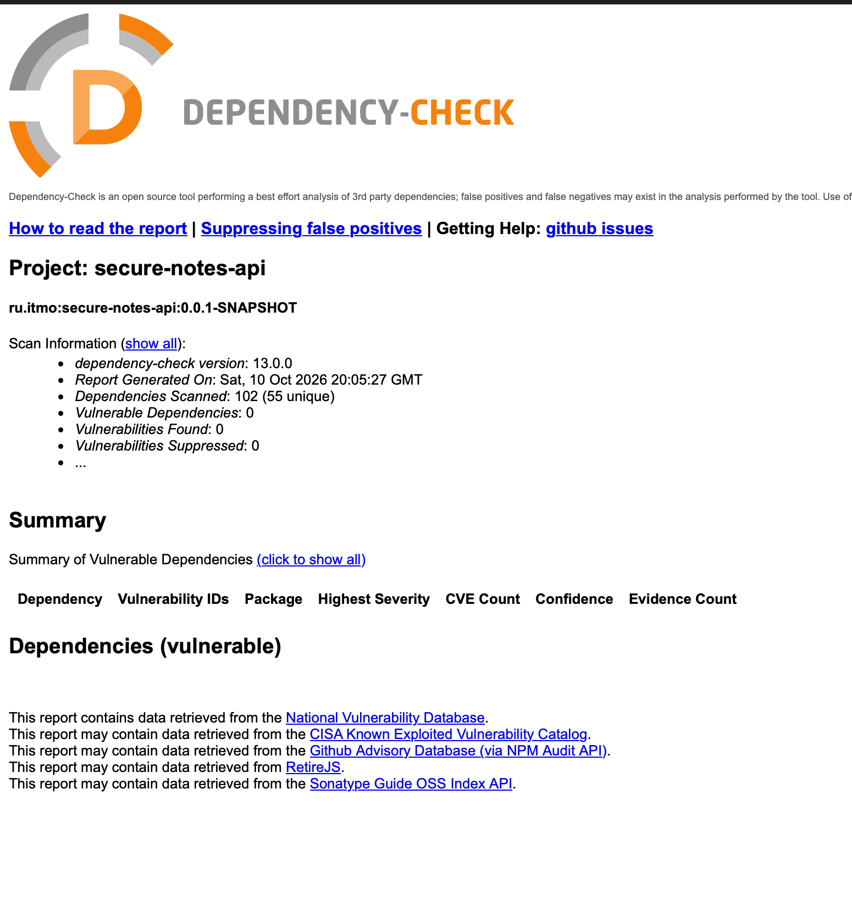
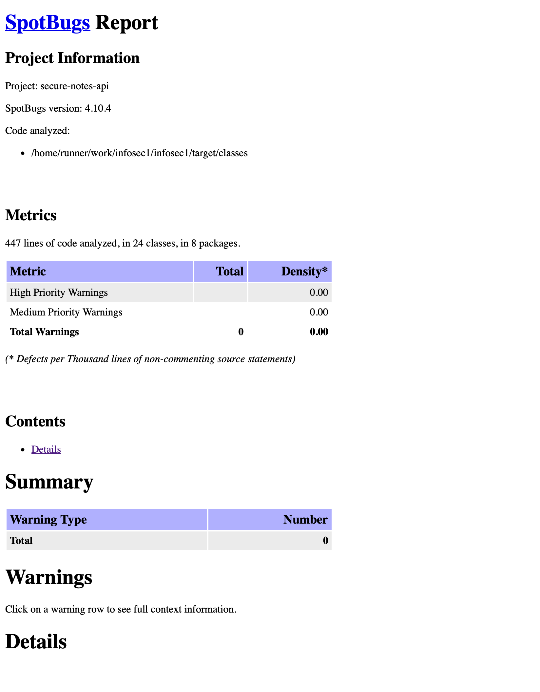

# Информационная безопасность

## Лабораторная работа № 1

**Тема:** «Разработка защищённого REST API с интеграцией в CI/CD»

Проект представляет собой REST API для хранения личных заметок. Пользователь проходит
аутентификацию по логину и паролю, получает JWT и после этого может создавать и читать
только собственные заметки.

### Стек

- Java 21, Spring Boot 4;
- Spring Web MVC;
- Spring Security и JWT;
- Spring Data JPA, Hibernate;
- PostgreSQL, Flyway;
- OWASP Java HTML Sanitizer;
- Maven, Docker Compose;
- GitHub Actions;
- SpotBugs, Find Security Bugs;
- OWASP Dependency-Check.

## Описание API

### `POST /auth/login`

Публичный метод для аутентификации. Принимает логин и пароль:

```json
{
  "username": "student",
  "password": "change-me"
}
```

Ограничения:

- `username` — непустая строка длиной до 64 символов;
- `password` — непустая строка длиной до 128 символов.

При правильных учётных данных сервер возвращает `200 OK` и JWT:

```json
{
  "accessToken": "<JWT>",
  "tokenType": "Bearer",
  "expiresIn": 900
}
```

При неправильном логине или пароле возвращается одинаковый ответ `401 Unauthorized`.

### `GET /api/data`

Возвращает заметки текущего пользователя. Метод доступен только с корректным JWT:

```http
GET /api/data
Authorization: Bearer <JWT>
```

Пример ответа `200 OK`:

```json
[
  {
    "id": "2f03e6db-4b09-4cc0-8ca8-f62411fa297b",
    "title": "Первая заметка",
    "content": "Содержимое заметки",
    "createdAt": "2026-10-10T12:00:00Z"
  }
]
```

UUID владельца берётся из поля `sub` проверенного JWT. Передать идентификатор другого
пользователя в запросе нельзя.

### `POST /api/data`

Создаёт заметку для текущего пользователя. Метод доступен только с корректным JWT.

```http
POST /api/data
Authorization: Bearer <JWT>
Content-Type: application/json
```

```json
{
  "title": "Первая заметка",
  "content": "Содержимое заметки"
}
```

Ограничения:

- `title` — непустая строка длиной до 120 символов;
- `content` — непустая строка длиной до 2000 символов.

Успешный запрос возвращает `201 Created` и созданную заметку. Ошибка валидации возвращает
`400 Bad Request`.

## Реализованные меры защиты

### Защита от SQL-инъекций

Работа с базой данных выполняется через Spring Data JPA и Hibernate. Репозитории используют
параметризованные запросы, а SQL не строится конкатенацией пользовательских строк.

В `UserRepository` и `NoteRepository` запросы описаны через методы Spring Data:

```java
Optional<User> findByUsername(String username);

List<Note> findAllByOwnerIdOrderByCreatedAtDesc(UUID ownerId);
```

Spring Data JPA передаёт эти методы Hibernate, а Hibernate формирует параметризованный SQL.
На уровне JDBC такой запрос выполняется через `PreparedStatement`. Упрощённо запрос поиска
пользователя выглядит так:

```sql
SELECT * FROM users WHERE username = ?
```

Знак `?` является местом для параметра. Само значение `username` передаётся отдельно от
SQL-команды, аналогично вызову `preparedStatement.setString(1, username)`. База данных
сначала получает структуру запроса, а затем значение параметра, поэтому содержимое строки
не может превратиться в SQL-оператор и изменить условие `WHERE`.

### Защита от XSS

Заголовок и содержимое заметки проходят следующую обработку:

1. Bean Validation проверяет обязательность и максимальную длину полей.
2. Строки нормализуются в Unicode-форме NFKC.
3. OWASP Java HTML Sanitizer удаляет HTML-теги и обработчики событий.
4. После санитизации повторно проверяются пустота и длина строки.
5. Ответ формируется JSON-сериализатором Jackson, а не конкатенацией строк.

Основная обработка находится в `NoteSanitizer`:

```java
private static final PolicyFactory PLAIN_TEXT_POLICY =
        new HtmlPolicyBuilder().toFactory();

public String sanitize(String input) {
    if (input == null) {
        throw new IllegalArgumentException("Note text must contain visible text");
    }
    String normalized = Normalizer.normalize(input, Normalizer.Form.NFKC)
            .replace("\r\n", "\n")
            .replace('\r', '\n')
            .strip();
    String sanitized = PLAIN_TEXT_POLICY.sanitize(normalized).strip();
    if (sanitized.isBlank()) {
        throw new IllegalArgumentException("Note text must contain visible text");
    }
    return sanitized;
}
```

Санитайзер вызывается для обоих пользовательских полей перед созданием сущности:

```java
String title = sanitizeWithinLimit(request.title(), 120, "title");
String content = sanitizeWithinLimit(request.content(), 2000, "content");

private String sanitizeWithinLimit(String value, int maximumLength, String field) {
    String sanitized = sanitizer.sanitize(value);
    if (sanitized.length() > maximumLength) {
        throw new IllegalArgumentException(field + " exceeds maximum length");
    }
    return sanitized;
}
```

### Аутентификация и авторизация

- пароли хранятся в виде BCrypt-хешей с cost factor 12;
- JWT подписывается алгоритмом HS256 и действует 15 минут;
- проверяются подпись, алгоритм, `issuer`, `audience`, срок действия и UUID в `sub`;
- серверные HTTP-сессии, form login и HTTP Basic отключены;
- `/auth/login` доступен без токена, `/api/**` требует аутентификацию;
- пользователь может читать и создавать только собственные заметки;
- JWT-секрет передаётся через переменную окружения и не хранится в репозитории.

BCrypt с параметром сложности 12 настраивается в `SecurityConfig`:

```java
private static final int BCRYPT_COST = 12;

@Bean
PasswordEncoder passwordEncoder() {
    return new BCryptPasswordEncoder(BCRYPT_COST);
}
```

При успешном входе UUID пользователя записывается в `sub`, после чего JWT подписывается
алгоритмом HS256:

```java
JwtClaimsSet claims = JwtClaimsSet.builder()
        .subject(principal.id().toString())
        .issuer(properties.issuer())
        .audience(List.of(properties.audience()))
        .issuedAt(issuedAt)
        .expiresAt(expiresAt)
        .id(UUID.randomUUID().toString())
        .build();

JwsHeader header = JwsHeader.with(MacAlgorithm.HS256).build();
String accessToken = jwtEncoder
        .encode(JwtEncoderParameters.from(header, claims))
        .getTokenValue();
```

Правила доступа также заданы в `SecurityConfig`:

```java
.authorizeHttpRequests(authorize -> authorize
        .requestMatchers("/auth/login").permitAll()
        .requestMatchers("/api/**").authenticated()
        .anyRequest().denyAll())
```

Для `GET /api/data` UUID владельца извлекается только из проверенного JWT, а затем
используется для фильтрации заметок:

```java
@GetMapping(produces = MediaType.APPLICATION_JSON_VALUE)
public List<NoteResponse> findAll(@AuthenticationPrincipal Jwt jwt) {
    return noteService.findAll(ownerId(jwt));
}

private UUID ownerId(Jwt jwt) {
    String subject = jwt.getSubject();
    if (subject == null) {
        throw new AuthenticationCredentialsNotFoundException(
                "Authenticated subject is missing");
    }
    return UUID.fromString(subject);
}
```

### Безопасная обработка входных данных и ошибок

- неизвестные JSON-поля отклоняются;
- методы с телом принимают только `application/json`;
- клиенту не возвращаются stack trace, SQL и внутренние сообщения исключений;
- JPA-сущности не передаются клиенту напрямую — API использует отдельные DTO;
- пароли, BCrypt-хеши, JWT и JWT-секреты не записываются в журнал приложения.

Ограничения входных данных объявлены непосредственно в DTO:

```java
public record CreateNoteRequest(
        @NotBlank @Size(max = 120) String title,
        @NotBlank @Size(max = 2000) String content) {
}
```

Внутреннее сообщение исключения не передаётся клиенту. Например, ошибки валидации получают
фиксированный безопасный ответ:

```java
@ExceptionHandler(IllegalArgumentException.class)
ResponseEntity<ErrorResponse> handleIllegalArgument(
        IllegalArgumentException exception) {
    logRejected(exception);
    return error(
            HttpStatus.BAD_REQUEST,
            "VALIDATION_FAILED",
            "Request validation failed");
}
```

## CI/CD

Workflow [`.github/workflows/ci.yml`](.github/workflows/ci.yml) запускается при каждом
`push` и `pull_request` и разделён на отдельные jobs:

1. `build` — сборка проекта командой `mvn --batch-mode clean verify`;
2. `sast` — компиляция всех Java-исходников и SAST-анализ SpotBugs с правилами Find Security Bugs;
3. `sca` — SCA-анализ зависимостей OWASP Dependency-Check.

Jobs `sast` и `sca` запускаются после успешного `build`. Каждый job загружает
только отчёты, созданные его собственной проверкой.

Для обновления базы NVD в GitHub Actions используется секрет `NVD_API_KEY`.

## Отчёты из pipeline

### Dependency-Check


### SpotBugs / Find Security Bugs

